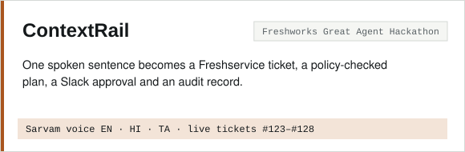
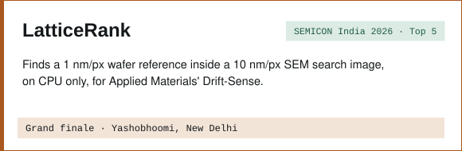
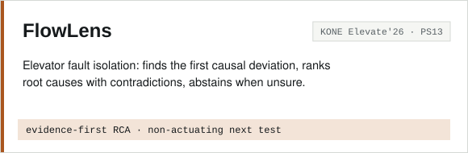
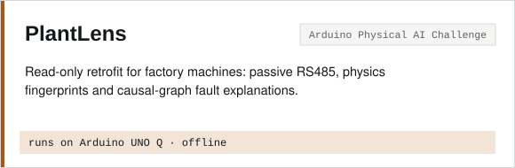
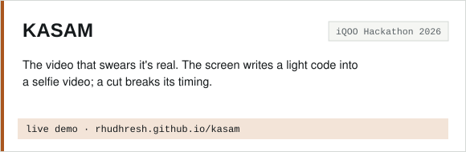
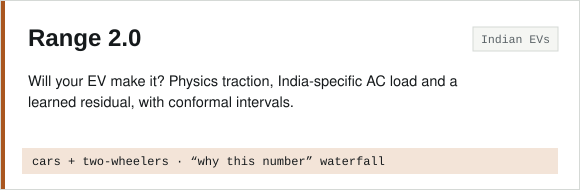
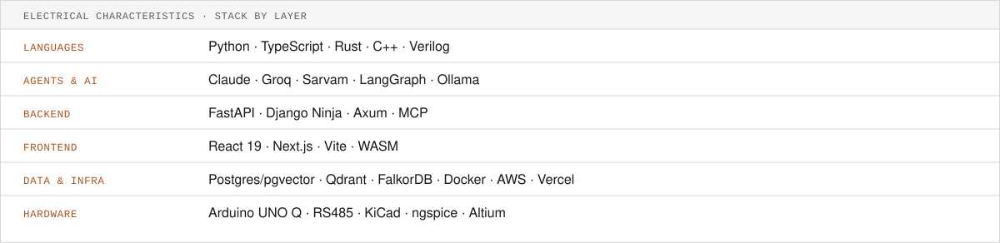

<picture>
  <source media="(prefers-color-scheme: dark)" srcset="assets/header-dark.svg">
  
</picture>

<a href="https://rhudhresh.github.io"><b>rhudhresh.github.io ↗</b></a> · <a href="https://rhudhresh.github.io/kasam/">Try KASAM live ↗</a>

I build **AI agents that take real actions** (approving access, routing money, isolating faults) and wrap them in rules a model can't override and evidence a judge can rerun. My electrical engineering side keeps the models tied to physics: batteries, motors, wafers, power feeders.

### Selected work

<a href="https://github.com/RHUDHRESH/contextrail"><picture><source media="(prefers-color-scheme: dark)" srcset="assets/card-contextrail-dark.svg"></picture></a>
<a href="https://github.com/RHUDHRESH/LatticeRank"><picture><source media="(prefers-color-scheme: dark)" srcset="assets/card-latticerank-dark.svg"></picture></a>
<a href="https://github.com/RHUDHRESH/FlowLens"><picture><source media="(prefers-color-scheme: dark)" srcset="assets/card-flowlens-dark.svg"></picture></a>
<a href="https://github.com/RHUDHRESH/Plantlens"><picture><source media="(prefers-color-scheme: dark)" srcset="assets/card-plantlens-dark.svg"></picture></a>
<a href="https://rhudhresh.github.io/kasam/"><picture><source media="(prefers-color-scheme: dark)" srcset="assets/card-kasam-dark.svg"></picture></a>
<a href="https://github.com/RHUDHRESH/range-2.0"><picture><source media="(prefers-color-scheme: dark)" srcset="assets/card-range-2.0-dark.svg"></picture></a>

### Competition record · 2026

| Event | Highlight | Build |
|---|---|---|
| **ABB Accelerator Student Hackathon** | 🥉 **3rd place** of 14,000+ registrations, 1,600+ teams · ₹1,00,000 · finale at ABB Innovation Center, Bengaluru | Industrial sustainability solution |
| **SEMICON India Hackathon** | 🏆 **National grand finalist**, 1 of 10 teams from 3,808 · Applied Materials track · Yashobhoomi, New Delhi | [LatticeRank](https://github.com/RHUDHRESH/LatticeRank) |
| Smart India Hackathon | Two problem statements, one team: renewable routing and edge voice capture | [HELIOROUTE](https://github.com/RHUDHRESH/sih-helioroute-validation) · [Edge Voice](https://github.com/RHUDHRESH/sih-voice-validation) |
| Freshworks Great Agent Hackathon | Live Freshservice tickets, Slack approvals, Sarvam voice in 3 languages | [ContextRail](https://github.com/RHUDHRESH/contextrail) |
| KONE Elevate'26 | Evidence-first elevator root-cause engine | [FlowLens](https://github.com/RHUDHRESH/FlowLens) |
| Arduino Physical AI Challenge | Running on Arduino UNO Q hardware, fully offline | [PlantLens](https://github.com/RHUDHRESH/Plantlens) |
| ASME Brain Bolt × Siemens Energy | 200 battery packs to 50 EVs with zero unsafe dispatches | [SafeFit-R](https://github.com/RHUDHRESH/asme-brainbolt-safefit-r) |
| iQOO Hackathon | Live tamper-evident video demo | [KASAM](https://github.com/RHUDHRESH/kasam) |
| GraphHacks | Graph-grounded agent that blocks bad releases | [Baton](https://github.com/RHUDHRESH/baton-change-verification) |

Also built for in 2026: Mitsubishi Electric AutomationX · atomQUEST · Schneider Electric Yuva Yodha · Amazon ML Challenge · Tata Teliport S4 · Namma AI (team leader) · Hack Apertus · Redrob India Runs · Seva First · RISE

<picture>
  <source media="(prefers-color-scheme: dark)" srcset="assets/stack-dark.svg">
  
</picture>

<picture>
  <source media="(prefers-color-scheme: dark)" srcset="https://raw.githubusercontent.com/RHUDHRESH/RHUDHRESH/output/snake-dark.svg">
  
</picture>

Header, cards and stack are hand-made SVGs generated by <code>gen.py</code> in this repo. The snake redraws daily from my contribution graph.
